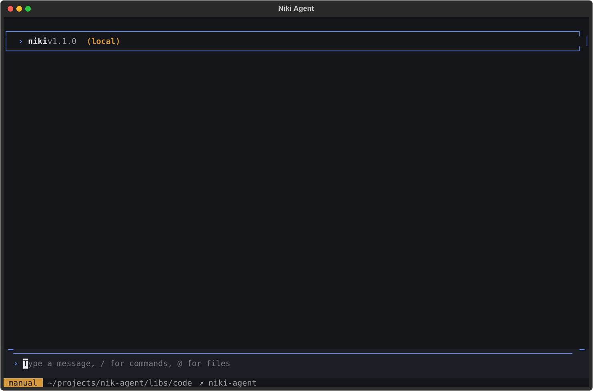

<div align="center">

# ◐ Niki Agent

*Calm, fast, keyboard-native. A terminal coding agent that gets out of the way.*

[](https://www.python.org)
[](https://textual.textualize.io)
[](NOTICE)

[Install](#install) · [Run it](#run-it) · [Independence](#independence) ·
[Themes](#themes) · [Providers](#providers) · [Docs](#docs)

</div>

<div align="center">
  
</div>

Niki Agent is an independent terminal coding agent. It runs on any model that
supports tool calling, keeps your sessions and memory on your machine, and puts
the whole agent loop in this repository — no runtime dependency on an upstream
agent package.

```bash
git clone https://github.com/RavaniRoshan/niki-agent.git
cd niki-agent/libs/code
uv sync --all-extras
uv run niki
```

> [!TIP]
> No API key is needed to try the interface. `niki` boots straight to a working
> composer. Set a key only when you want it to actually do something:
> `export ANTHROPIC_API_KEY=sk-ant-...`

---

## Install

### From a release (recommended)

Linux and macOS:

```bash
curl -fsSL https://raw.githubusercontent.com/RavaniRoshan/niki-agent/niki-agent/install/install.sh | bash
```

Windows (PowerShell):

```powershell
irm https://raw.githubusercontent.com/RavaniRoshan/niki-agent/niki-agent/install/install.ps1 | iex
```

The installer creates an isolated environment under `~/.local/niki`
(`%LOCALAPPDATA%\niki` on Windows) and puts `niki` on your `PATH`.

### From source

Requires Python 3.12+ and [uv](https://docs.astral.sh/uv/).

```bash
git clone https://github.com/RavaniRoshan/niki-agent.git
cd niki-agent/libs/code
uv sync --all-extras
```

Install just one provider's extra instead of all of them with
`uv sync --extra anthropic`.

## Run it

```bash
uv run niki                      # interactive
uv run niki --help               # usage and options
uv run niki --version            # Niki Agent 1.0.0
uv run niki -n "summarize this repo"   # headless
```

## Independence

- **Own module and distribution.** `niki_agent`, published as `niki-agent`.
- **Own state.** `~/.niki`; the old `~/.deepagents` profile is migrated on first
  launch and a marker records the move.
- **Own environment namespace.** `NIKI_*`. Old `DEEPAGENTS_CODE_*` names are
  read once and copied, with a deprecation notice.
- **Own agent loop.** The Deep Agents SDK is vendored under
  `libs/code/niki_agent/sdk/` with its MIT notice and a provenance file. The ACP
  integration is vendored the same way.
- **Deprecated aliases.** `dcode` and `deepagents-code` still launch the product
  for two minor versions and print a one-line notice.

## What it feels like

| | |
| --- | --- |
| Idle redraws over 5 s | **0** |
| Render cost, worst case vs. a short transcript | **1.21×** |
| Resident memory, long session | **255 MB** |
| Composer | a single rule, not a box |
| Update check / auto-update | on, with `NIKI_DISABLE_*` opt-outs |

- **A theme layer.** Registered through the theme registry. Every colour comes
  from one module.
- **Its own motion.** A ping-ponging `◐◓◑◒` sweep with adaptive cadence, and
  `NIKI_REDUCED_MOTION` for stillness.
- **A bounded mount window.** Keeps a long transcript from dragging the render
  cost with it.

## Themes

Four palettes, switchable at runtime with `/theme`:

| Name | For |
| --- | --- |
| `niki` | The default. Cool, flat greys, one accent. |
| `niki-light` | Light terminals. |
| `niki-contrast` | Bright rooms and low-quality panels — tightest pair 6.22:1. |
| `niki-dim` | Dark rooms, where the default reads too bright. |

All four measure **zero contrast violations**: text at 4.5:1, UI glyphs at 3:1,
against every surface they sit on. That is a test, not a claim.

```bash
NO_COLOR=1 uv run niki                     # colour off
NIKI_UI_CHARSET_MODE=ascii uv run niki     # ASCII glyph fallback
NIKI_REDUCED_MOTION=1 uv run niki          # no animation
```

## Providers

Nine ship already — Anthropic, OpenAI, Google, Ollama, OpenRouter, NVIDIA, Groq,
Together, DeepSeek. More are configured rather than compiled in:

```toml
# ~/.niki/config.toml
[providers.kimi]
display_name = "Kimi"
class_path = "langchain_openai:ChatOpenAI"
base_url = "https://api.moonshot.ai/v1"
api_key_env = "MOONSHOT_API_KEY"
models = ["kimi-k3", "kimi-k2.7-code", "kimi-k2.6"]
```

Full details, caveats, and the Kilo and OpenCode Zen blocks are in
[`docs/niki/PROVIDERS.md`](docs/niki/PROVIDERS.md).

## Docs

| | |
| --- | --- |
| [`CHECKLIST.md`](docs/niki/CHECKLIST.md) | Every product row with its real status and evidence. |
| [`INDEPENDENCE.md`](docs/niki/INDEPENDENCE.md) | The rename, the aliases, and the migration rules. |
| [`BASELINE.md`](docs/niki/BASELINE.md) | Before/after numbers and the commands behind them. |
| [`OWNER_VERIFY.md`](docs/niki/OWNER_VERIFY.md) | What still needs a real terminal and a real key. |
| [`KEYMAP.md`](docs/niki/KEYMAP.md) | Every key binding, generated from the registry. |
| [`PROVIDERS.md`](docs/niki/PROVIDERS.md) | Provider setup and gateway notes. |
| [`UI_PARITY.md`](docs/niki/UI_PARITY.md) | Rows checked against the current Claude Code CLI. |
| [`PROGRESS.md`](docs/niki/PROGRESS.md) | Build log, including the turns that were wrong. |

**Status: 57 WORKS · 0 PARTIAL · 0 MISSING** across the 57 checklist rows. Every
row carries the test, PTY run, or measured probe that decides it.

## Tests

```bash
cd libs/code
uv run pytest tests/unit_tests/niki/ -q    # no network, no API key, no terminal
```

## License

MIT. The Deep Agents copyright notice is retained in [`NOTICE`](NOTICE) and
[`LICENSE`](LICENSE). Vendored code carries a provenance note beside it; that
attribution is a legal requirement and is never removed by branding work.
