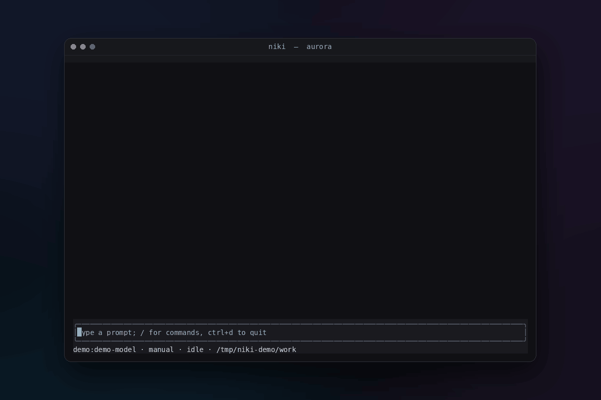

<div align="center">

# niki

**A quiet terminal coding agent, written in Rust.**

One native binary. Eleven providers. Sessions on your disk.
An approval card in front of anything that changes your machine.

[](https://github.com/RavaniRoshan/niki-agent/releases)
[](rust/)
[](LICENSE)

[Install](#install) · [Download](https://niki-site.vercel.app/download) · [Documentation](https://niki-docs.vercel.app) · [Changelog](https://niki-site.vercel.app/changelog) · [Beta](#beta)

</div>

<div align="center">
  
</div>

<p align="center"><sub>Recorded from the shipped binary against a loopback model, with no key and no network. The card in the middle is the approval gate.</sub></p>

## What it is

Niki runs in your terminal. You describe a change; it reads the repository,
proposes an edit or a command, and waits for your answer before anything touches
your machine. Approve once, allow it for the session, or refuse — and the model
is told what you decided, so the turn continues instead of dying.

It is one native executable built from [`rust/`](rust/): the turn loop, the
providers, the tools, the policy, the sessions, the MCP client, and the
full-screen UI. There is no interpreter to install, no virtual environment to
create, and nothing to resolve on first run.

No account, no telemetry, no subscription. You bring a key for the model you
already pay for, or point Niki at a local daemon.

```bash
curl -fsSL https://raw.githubusercontent.com/RavaniRoshan/niki-agent/niki-agent/install/install.sh | bash
niki
```

No key is needed to look around: the first launch lands on a working composer
with the current folder, model, and approval mode already named. Add a key when
you want it to work:

```bash
export ANTHROPIC_API_KEY=sk-ant-...
```

## Why this one

A generic agent gives you a chat box and a lot of motion. Niki is built around
what a long session actually costs you: attention, trust, and startup time.

| | |
| --- | --- |
| **The gate is the product** | Every gated action arrives as a card that names the command or the absolute path, says whether it resolves inside the workspace, offers *allow once / allow for this session / refuse*, and keeps the conversation on screen behind it. |
| **One binary, no runtime** | The turn loop, providers, tools, policy, sessions, MCP, and UI compile into a single executable. The release archive is about 5 MiB and needs nothing else installed. |
| **Open providers, no proxy** | Eleven providers are built in — Anthropic, OpenAI, Gemini, Groq, OpenRouter, Together, DeepSeek, NVIDIA, Mistral, xAI, Ollama — plus any OpenAI-compatible endpoint by config. You pay your provider directly; there is no billing layer in between. |
| **Local by conviction** | Sessions, skills, credentials, and the trust store live in `~/.niki`. No account, no cloud sync, no update check, no remote config. |
| **Starts in milliseconds** | `niki --version` returns in 1.8 ms on a Ryzen 7 4800H (mean of 20 runs after 5 warm-ups); there is no interpreter to boot and no import graph to warm. |
| **Quiet by default** | An idle session draws a welcome block and one composer rule, not a box. Tool output collapses to a row you can open. |
| **Delegation with a budget** | The `task` tool gives one child agent a fresh history, a fixed step budget, and no way to spawn further children. |
| **Scriptable when you need it** | `niki -n` answers once on stdout; `--output-format jsonl` streams a turn as events for your own tooling. |

## Install

**Linux, WSL, and macOS**

```bash
curl -fsSL https://raw.githubusercontent.com/RavaniRoshan/niki-agent/niki-agent/install/install.sh | bash
```

**Windows**

```powershell
irm https://raw.githubusercontent.com/RavaniRoshan/niki-agent/niki-agent/install/install.ps1 | iex
```

The installer picks the archive for your platform, verifies it against the
release's `SHA256SUMS`, and places one executable under `~/.local/niki`
(`%LOCALAPPDATA%\niki` on Windows). It does not touch your shell profile unless
you pass `NIKI_SHELL=1`. To remove Niki, delete `~/.local/niki` and `~/.niki`.

Every archive, its size, its checksum, and the one-line verification command are
on the [download page](https://niki-site.vercel.app/download). Linux, WSL, and
macOS are exercised by the release workflow; the Windows archive is built by CI
but has not been executed on Windows, and the
[beta page](https://niki-docs.vercel.app/beta) tracks platform support.

Requires a 64-bit Linux, macOS (Apple silicon or Intel), or Windows machine.
Building from source needs Rust 1.85 or newer:

```bash
git clone https://github.com/RavaniRoshan/niki-agent.git
cd niki-agent/rust
cargo build --release -p niki --bin niki
```

## First five minutes

```bash
niki                             # interactive session in the current directory
niki -n "summarize this repo"    # one answer on stdout, no full-screen UI
niki --help                      # every flag
```

Type a request and press Enter. `Shift+Tab` cycles approval modes, `/model`
picks a provider and model, `/theme` changes the palette, `/resume` restores a
saved session, `/threads` browses them, `/context` shows what the conversation
costs, `/diff` renders the working tree, and `/help` lists every command.

`AGENTS.md` and `.niki/AGENTS.md` are read from the repository root down to the
working directory, under a 32 KiB budget that truncates by line and says so.
`/init` writes a starter file only when one is missing.

Project hooks, skills, and instruction files run as you, so they load only after
`niki trust` records the workspace. `niki untrust` withdraws the grant and
`niki trust --list` shows what you allowed.

## The approval gate

`Shift+Tab` cycles **Manual → Auto → YOLO**; the status bar names the active
mode.

| Mode | What runs without asking first |
| --- | --- |
| Manual | Every gated action asks, except shell commands on the allow-list. |
| Auto | Allow-listed shell commands and writes inside the workspace run; everything else asks. |
| YOLO | Everything the policy allows runs unsupervised. |

None of the modes is a sandbox: Niki runs with your user's permissions. The
workspace path boundary keeps file tools inside the project unless the
configuration widens it. A headless run has nobody to ask, so a gated action is
reported back to the model as a refusal; pass `--mode auto` or `--mode yolo` when
that is what you want.

## Providers

Eleven providers are built in. Name the model and set the provider's key
variable:

```toml
[models]
default = "groq:llama-3.3-70b-versatile"
```

Anything else with an OpenAI-compatible API is configuration, not code:

```toml
[models]
default = "moonshot:kimi-k3"

[providers.moonshot]
display_name = "Moonshot"
base_url = "https://api.moonshot.ai/v1"
api_key_env = "MOONSHOT_API_KEY"
models = ["kimi-k3", "kimi-k2.7-code"]
```

MCP servers live in the same file, with `${VAR}` expanded from the environment:

```toml
[mcp_servers.docs]
command = "npx"
args = ["-y", "@example/docs-server"]
timeout = 30
```

Setup details, gateway examples, and the full config key list are in
[`docs/niki/PROVIDERS.md`](docs/niki/PROVIDERS.md).

## Beta

Niki is usable today and still moving. Beta builds ship as GitHub
pre-releases: they pass the same Rust test gate as a stable release but may
change behaviour between builds. Pin one by its version (no leading `v`):

```bash
curl -fsSL https://raw.githubusercontent.com/RavaniRoshan/niki-agent/niki-agent/install/install.sh \
  | NIKI_VERSION=2.2.0-beta.1 bash
```

Known gaps, the support matrix, and how to report a problem are on the
[beta page](https://niki-docs.vercel.app/beta). Feedback belongs in the
[beta feedback issue form](https://github.com/RavaniRoshan/niki-agent/issues/new?template=beta-feedback.yml);
the [roadmap issue](https://github.com/RavaniRoshan/niki-agent/issues/114) lists
what is shipped and what is next. Every release is written up on the
[changelog page](https://niki-site.vercel.app/changelog) and in
[`CHANGELOG.md`](CHANGELOG.md).

## Docs

| | |
| --- | --- |
| [Documentation site](https://niki-docs.vercel.app) | Install, first turn, providers, keymap, permissions, security. |
| [`docs/niki/KEYMAP.md`](docs/niki/KEYMAP.md) | Every key binding. |
| [`docs/niki/UI.md`](docs/niki/UI.md) | The screen, the glyphs, the motion schedule, and the `[ui]` settings. |
| [`docs/niki/ARCHITECTURE.md`](docs/niki/ARCHITECTURE.md) | How the agent, the UI, and the tools fit together. |
| [`docs/niki/INDEPENDENCE.md`](docs/niki/INDEPENDENCE.md) | Package, state, and environment guarantees. |
| [`SECURITY.md`](SECURITY.md) | How to report a vulnerability, and what is in scope. |

## Development

```bash
cd rust
cargo fmt --all -- --check
cargo clippy -j 2 --workspace --all-targets -- -D warnings
cargo test -j 2 --workspace
```

The workspace is split by responsibility: `niki-agent` owns the turn loop,
`niki-provider` the wire clients, `niki-tools` the filesystem and shell tools,
`niki-policy` the approval decisions, `niki-session` the SQLite history,
`niki-mcp` the MCP clients, and `niki-tui*` the full-screen app.
[`docs/niki/ARCHITECTURE.md`](docs/niki/ARCHITECTURE.md) maps the crates and the
turn loop.

See [`CONTRIBUTING.md`](CONTRIBUTING.md) for setup, the checks CI runs, and
commit conventions. Release steps are in [`.github/RELEASING.md`](.github/RELEASING.md).

## Security

Niki runs commands and edits files with your permissions. Report
vulnerabilities privately — see [`SECURITY.md`](SECURITY.md). Release archives
are covered by `SHA256SUMS`, and both installers verify it before installing.

## License

MIT. Third-party copyright notices are retained in [`NOTICE`](NOTICE).
