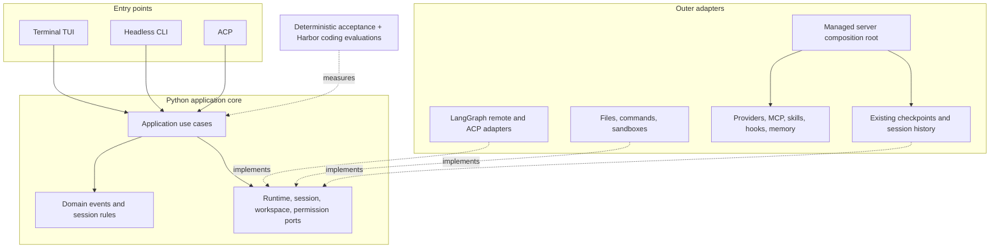

# Niki Agent Architecture and Product Implementation Plan

> **For agentic workers:** REQUIRED SUB-SKILL: Use `superpowers:subagent-driven-development` (recommended) or `superpowers:executing-plans` to implement this plan task-by-task. Steps use checkbox (`- [ ]`) syntax for tracking.

**Goal:** Evolve the existing Python Niki CLI into a dependable, extensible open-source coding agent with clear runtime boundaries, strong terminal UX, and the agent capabilities shown in the supplied architecture references; defer the Rust rewrite until Python behavior is complete and measured.

**Architecture:** Keep a modular Python monolith with inward dependency flow: framework-free domain and application contracts, ports for runtime/session/workspace/permission operations, and adapters for LangGraph, the current managed server, ACP, Textual, providers, MCP, and execution environments. Preserve the current client/server split and migrate behavior through tested seams instead of replacing the existing harness in one pass.

**Tech Stack:** Python `>=3.12,<4.0`; current LangGraph server/runtime and LangChain provider integrations behind adapters; Textual TUI; existing SQLite checkpoint/session facilities; `uv`, `make`, `ruff`, `ty`, and `pytest`.

**Spec:** This request and its three supplied architecture screenshots; current repository baseline and ownership notes in `docs/niki/DESIGN.md`, `docs/niki/PROGRESS.md`, `docs/niki/CHECKLIST.md`, `libs/code/AGENTS.md`, and `openwiki/architecture/code-agent.md`.

## Global Constraints

- Keep the active implementation in Python. Begin the Rust rewrite only after the Python completion gates in Task 12 pass.
- Keep `libs/deepagents` unchanged; preserve `dcode` and `deepagents-code` entry point behavior while Niki evolves behind `niki`.
- Keep the existing client/server ownership split: the client owns input, approvals, and presentation; the managed server owns graph execution, tools, workspace policy, and checkpoints. ACP remains a distinct adapter until its behavior is covered by the shared contracts.
- Keep this as a modular monolith with explicit ports; do not introduce microservices or a second event-sourced database for features the current server/checkpointer already owns.
- Use LangGraph as the current graph/runtime engine and LangChain integrations for model providers. Keep both behind outer adapters; do not make domain or application code depend on either framework.
- Keep `niki_agent.domain` and `niki_agent.application` importable without importing Textual, Rich, Deep Agents, LangChain, or LangGraph.
- Reuse the existing session/checkpoint, provider, workspace, MCP, hooks, skills, memory, goals, subagent, and QuickJS implementations where they already meet the contract. Do not create a second source of truth or reimplement an existing capability without a failing behavior test.
- Treat coding quality as an evaluated product requirement: capture the current baseline before changing runtime behavior, keep benchmark tasks/configuration fixed during a comparison, and require deterministic safety and recovery checks alongside model-based task scores.
- Architecture patterns are constraints in service of working behavior, not a reason to add layers by default. Keep the modular monolith and add an abstraction only when it removes a demonstrated dependency or makes a tested capability easier to change.
- Do not describe Niki as “perfect” or “Claude Code equivalent” based on architecture diagrams or unit tests. Such a claim requires the matched benchmark and reliability evidence in `docs/niki/EVALUATION.md`.
- Preserve approval defaults and workspace identity checks. Approval decisions must be enforced by the execution side, not inferred from TUI display state.
- Retain upstream license, copyright, and required attribution notices while creating Niki branding and distribution metadata.
- Keep untrusted script execution in the existing QuickJS or configured sandbox boundary. Do not use Python `eval()`, `exec()`, or `pickle` on user-controlled data.
- Preserve startup performance rules in `libs/code/AGENTS.md`: heavy imports stay off trivial CLI paths, and background subprocesses have timeouts.
- Do not add runtime dependencies unless a task demonstrates a requirement and records the maintenance reason.
- Use the repository’s `uv`/`make` workflow, typed Python, Ruff, `ty`, and network-free unit tests for core behavior.
- Install/reference the requested skill with `npx skills add https://github.com/wshobson/agents --skill architecture-patterns`. This checkout already contains `.agents/skills/architecture-patterns/` and a `skills-lock.json` entry for `wshobson/agents`; verify those before re-running the command.

## Review Focus

- A malicious repository instruction, symlink, or tool result must not expand access beyond the approved workspace; cover in Tasks 5–6 with `test_symlink_escape_is_rejected_before_write` and `test_repository_prompt_injection_cannot_authorize_a_tool`.
- A client/server interruption during a streamed turn must leave the session resumable without duplicating a completed tool action; cover in Task 4 with `test_interrupted_turn_resumes_without_repeating_completed_tool`.
- Provider timeouts, rate limits, MCP disconnects, and worker failures must end visibly, release owned resources, and preserve a recoverable session; cover in Tasks 4, 7, and 10 with `test_provider_timeout_emits_recoverable_failure`, `test_failed_team_member_is_reported_and_siblings_are_cancelled`, and `test_mcp_disconnect_is_visible_and_cleanup_is_idempotent`.
- Malformed, oversized, or terminal-control-bearing stream data must not corrupt transcript state or reach the terminal unfiltered; cover in Tasks 1, 3, and 11 with `test_run_event_rejects_invalid_envelope`, `test_run_event_rejects_oversized_payload`, and `test_untrusted_stream_text_is_sanitized_at_render_boundary`.
- Deep history and large tool output must remain bounded while older messages remain hydratable; cover in Task 11 with `test_five_thousand_message_history_stays_bounded_and_hydratable`. The existing evaluator already treats missing rollouts as failures; preserve and run `.github/scripts/tests/evals/test_aggregate_shards.py::test_missing_rollouts_count_as_failures` in Task 0.

---

## Architecture Map



## File Structure

The plan introduces only the seams needed to separate ownership. Existing feature modules remain the implementation source until an adapter migration proves behavior parity.

- `libs/code/niki_agent/domain/` — framework-free session, permission, and event types.
- `libs/code/niki_agent/application/` — run/session use cases and port protocols; no Textual or LangChain imports.
- `libs/code/niki_agent/adapters/runtime/` — adapters around the existing `RemoteAgent`/LangGraph stream and ACP execution path.
- `libs/code/niki_agent/adapters/workspace/` — adapters to the existing filesystem backends, command execution, and sandbox registry.
- `libs/code/niki_agent/niki/` — Niki entry point, product presentation, command palette, run summary, and UI defaults.
- Existing ownership stays in place initially: `agent.py` and `server_graph.py` assemble the graph; `client/remote_client.py`, `client/non_interactive.py`, and `tui/textual_adapter.py` handle current stream surfaces; `sessions.py` and LangGraph checkpointers own persistence; `server_graph.py` composes `model_config.py`, `mcp_*`, `hooks/`, `skills/`, `goal_*`, and `langchain_quickjs` without exposing another model/tool execution path.
- `docs/niki/EVALUATION.md` — benchmark protocol, baseline, metrics, and Python/Rust readiness thresholds; reuse `libs/evals` and its Harbor workflows rather than creating a parallel evaluator.
- `docs/niki/evaluations/BASELINE.md` — immutable record of the pre-change model, harness, task set, run IDs, scores, costs, and known failures.
- Tests live beside the existing package suites under `libs/code/tests/unit_tests/`, `libs/code/tests/unit_tests/niki/`, and `libs/partners/quickjs/tests/unit_tests/`.

### Task 0: Establish a reproducible quality baseline

**Files:**
- Create: `docs/niki/EVALUATION.md`
- Create: `docs/niki/evaluations/BASELINE.md`
- Modify: `libs/evals/pyproject.toml` and `libs/evals/uv.lock` to pin `harbor==0.25.0`, which is the evaluator used for Terminal-Bench 4.1 and its Claude Code agent adapter; keep evaluator dependencies out of `libs/code` runtime dependencies.
- Modify: `libs/evals/Makefile` to add `run-niki-terminal-bench` and `run-claude-code-terminal-bench` targets with identical benchmark inputs and separate output directories `harbor-jobs/niki-terminal-bench/` and `harbor-jobs/claude-code-terminal-bench/`. Both use `NIKI_BENCH_MODEL=anthropic:claude-opus-5-5`, `NIKI_BENCH_REASONING_EFFORT=max`, `HARBOR_SANDBOX_ENV=langsmith`, `HARBOR_AGENT_TIMEOUT_MULTIPLIER=1.0`, and `HARBOR_RETRIES=0` by default.
- Create: `libs/evals/scripts/compare_niki_terminal_bench.py`
- Create: `libs/evals/tests/unit_tests/test_niki_competitor_eval.py`
- Test: `.github/scripts/tests/evals/test_aggregate_shards.py::test_missing_rollouts_count_as_failures` (existing completeness guard; preserve it)

**Interfaces:**
- Uses the existing Harbor integration in `libs/evals`; Niki is evaluated through the existing `dcode` product graph and the actual `niki -n` process gets a separate isolated-workspace smoke check. Do not substitute `bare` as the Niki result.
- Defines one repeatable process-level smoke case in `docs/niki/EVALUATION.md`: in a fresh temporary repo, ask Niki to update `parser.py` so `parse_host_port("example.test:443") == ("example.test", 443)`, `parse_host_port("127.0.0.1:80") == ("127.0.0.1", 80)`, and `parse_host_port("[2001:db8::1]:443") == ("2001:db8::1", 443)`. It must raise `ValueError` for `"[2001:db8::1:443"`, `"2001:db8::1]:443"`, `"host:abc"`, and `"host:65536"`, then run `python -m pytest -q test_parser.py`. The initial `parser.py` uses a simple `partition(":")` and fails the IPv6 case; only `parser.py` may change.
- Pins the coding benchmark to the official [Terminal-Bench 4.1](https://www.tbench.ai/) dataset and Harbor 0.25.0. The paired comparison runs Niki (`dcode` graph adapter) and Claude Code on the same task revision, model `anthropic:claude-opus-5-5`, reasoning effort `max`, unattended permission mode inside the benchmark’s isolated sandbox, `langsmith` sandbox image, task-default timeout (`HARBOR_AGENT_TIMEOUT_MULTIPLIER=1.0`), and three independent trials per task (`HARBOR_RETRIES=0`). If the pinned Harbor release cannot run both agents under those same settings, fix the evaluator adapter before collecting comparison scores; do not compare unlike configurations.
- The Niki target uses Harbor's `langgraph` agent with graph `dcode`; the competitor target uses Harbor's `claude-code` agent. Both targets accept `MAX_TASKS=2` for smoke runs, default to the complete task set, and write to their separate job directories above. `load_trial_results(job_dir: Path)` reads all `trial_result.json` files from the pinned Harbor job layout and rejects missing, duplicate, or malformed trial data.
- Produces `TrialResult(task_id: str, trial_id: str, reward: float, duration_seconds: float, total_tokens: int | None, cost_usd: float | None)` and `ComparisonReport(niki_resolution_rate: float, claude_code_resolution_rate: float, difference: float, difference_ci_95: tuple[float, float], task_count: int, trial_count_per_task: int, niki_pass_at_1: float, claude_code_pass_at_1: float, niki_pass_at_3: float, claude_code_pass_at_3: float, niki_median_seconds: float, niki_p95_seconds: float, claude_code_median_seconds: float, claude_code_p95_seconds: float, niki_cost_per_task_usd: float | None, claude_code_cost_per_task_usd: float | None)`. Resolution means reward `== 1.0`; resolution rate is the mean across all task-trials, and `pass@3` means at least one successful trial per task.
- Produces `load_trial_results(job_dir: Path) -> list[TrialResult]` and `compare_results(niki: Sequence[TrialResult], claude_code: Sequence[TrialResult], *, bootstrap_samples: int = 10_000, seed: int = 20261123) -> ComparisonReport`. The paired bootstrap resamples the shared task IDs with replacement and computes the 2.5th/97.5th percentiles of Niki-minus-Claude-Code resolution-rate differences. It rejects missing tasks, missing trials, duplicate trial IDs, and mismatched trial counts instead of silently comparing partial runs.
- Exports baseline machine-readable evidence to `docs/niki/evaluations/terminal-bench-baseline-comparison.json`; `BASELINE.md` links to the baseline Harbor job directories and captures aggregate scores and exact run configuration. No test or source code change may alter or filter the pinned benchmark task set after the comparison starts.
- Records the exact Niki commit, benchmark and Harbor versions, model identifier/settings, task count, sandbox, timeout, retry policy, all per-task outcomes, pass@1, pass@3, 95% confidence intervals, median/p95 duration, token use, and cost where provided. Missing or timed-out trials count as failures; retries are disabled for scored attempts.
- Defines “competitive with Claude Code” as Niki’s Terminal-Bench 4.1 mean trial resolution rate being at least 55% and no more than 10 percentage points below the matched Claude Code result, with the lower bound of the paired 95% bootstrap confidence interval for the difference at or above −10 percentage points. A result from a different model, benchmark version, budget, or permission mode is descriptive only and cannot satisfy this gate.
- Uses the existing fixed `autonomous`/`dcode` lite profile with three rollouts for inexpensive regression checks during development. Run the full matched benchmark only at the Python readiness gate; use the two-task smoke run to estimate cost, record actual spend, and do not silently shrink or replace its task set.

- [ ] **Step 1: Add benchmark comparison and command tests**

  Add `test_paired_comparison_rejects_incomplete_or_mismatched_task_trials`, `test_paired_bootstrap_reports_zero_for_identical_agents`, and `test_harbor_runner_targets_use_same_terminal_bench_inputs`. Assert both Makefile targets pin `harbor==0.25.0`, `terminal-bench@4.1`, `NIKI_BENCH_MODEL=anthropic:claude-opus-5-5`, `NIKI_BENCH_REASONING_EFFORT=max`, `HARBOR_SANDBOX_ENV=langsmith`, `HARBOR_AGENT_TIMEOUT_MULTIPLIER=1.0`, three attempts, unattended isolated-sandbox permissions, and `HARBOR_RETRIES=0`. The targets accept `MAX_TASKS=2` for a two-task smoke run and default to the entire dataset when unset. Keep `.github/scripts/tests/evals/test_aggregate_shards.py::test_missing_rollouts_count_as_failures` as the separate incomplete-run guard; do not add a duplicate score aggregator.

- [ ] **Step 2: Run the focused eval configuration tests**

  Run: `cd libs/evals && uv run pytest tests/unit_tests/test_niki_competitor_eval.py -q`

  Run: `uv run --project libs/evals pytest .github/scripts/tests/evals/test_aggregate_shards.py::test_missing_rollouts_count_as_failures -q`

  Expected: PASS with deterministic zero-difference confidence bounds for identical fixtures, errors for incomplete/mismatched fixtures, and matching inputs in both Harbor commands.

- [ ] **Step 3: Capture the pre-change baseline before Task 1**

  Run the existing unified eval workflow with `models=anthropic:claude-opus-5-5`, `categories=autonomous`, `agent_impls=dcode`, `profile=lite`, and `rollouts=3` on the current checkout. Run the actual `niki -n` process on the fixed parser smoke case from `docs/niki/EVALUATION.md` in a fresh temp repo and save its output, exit code, verifier result, and diff summary. First run `make run-niki-terminal-bench MAX_TASKS=2` and `make run-claude-code-terminal-bench MAX_TASKS=2` to validate setup and estimate cost. Then run both targets without `MAX_TASKS` on the full pinned Terminal-Bench 4.1 task set, with three trials per task and the matched settings above. Use a clean sandbox for every trial and preserve both Harbor job IDs and exact commits in `docs/niki/evaluations/BASELINE.md`. Full model-based runs are manual/release gates; do not add credentials or full benchmark execution to ordinary unit-test CI.

- [ ] **Step 4: Document baseline and comparison rules**

  Complete `docs/niki/EVALUATION.md` with the exact commands, benchmark version, matching conditions, metric definitions, confidence-interval method, cost reporting, and gates from the Interfaces block. Run `compare_niki_terminal_bench.py` against the two Harbor job directories and save the full JSON report as `terminal-bench-baseline-comparison.json`. Complete `BASELINE.md` with actual observed evidence; do not fill missing scores with estimates.

- [ ] **Step 5: Commit the protocol and baseline evidence**

  ```bash
  git add libs/evals/pyproject.toml libs/evals/uv.lock libs/evals/Makefile libs/evals/scripts/compare_niki_terminal_bench.py libs/evals/tests/unit_tests/test_niki_competitor_eval.py docs/niki/EVALUATION.md docs/niki/evaluations/BASELINE.md docs/niki/evaluations/terminal-bench-baseline-comparison.json
  git commit -m "test(code): establish Niki coding quality baseline"
  ```

### Task 1: Establish the Python architecture contracts

**Files:**
- Create: `libs/code/niki_agent/domain/__init__.py`
- Create: `libs/code/niki_agent/domain/events.py`
- Create: `libs/code/niki_agent/domain/session.py`
- Create: `libs/code/niki_agent/application/__init__.py`
- Create: `libs/code/niki_agent/application/ports/__init__.py`
- Create: `libs/code/niki_agent/application/ports/sessions.py`
- Create: `libs/code/niki_agent/application/ports/runtime.py`
- Create: `docs/niki/ARCHITECTURE.md`
- Modify: `libs/code/tests/unit_tests/test_architecture_imports.py` (currently untracked in the checkout; preserve its existing assertions)
- Test: `libs/code/tests/unit_tests/test_niki_runtime_contract.py`

**Interfaces:**
- Produces frozen, slotted `RunEvent(schema_version: int, event_id: str, session_id: str, turn_id: str, sequence: int, kind: RunEventKind, payload: JsonObject)` and `encode_run_event(event: RunEvent) -> str` / `decode_run_event(raw: str) -> RunEvent`.
- Produces `SessionSummary(session_id: str, workspace_root: str, title: str | None, updated_at: str)`, where `updated_at` is an RFC 3339 UTC timestamp and list results are newest-first.
- Produces `RunEventKind` and `TurnStatus` as `StrEnum`s. `TurnStatus` values are `created`, `running`, `waiting_for_approval`, `completed`, `failed`, and `cancelled` for lifecycle validation in the application layer; the existing graph checkpoint remains the durable execution state.
- Produces `TurnRequest(session_id: str, turn_id: str, prompt: str, workspace_root: str)` and `ResumeRequest(session_id: str, turn_id: str, decision: JsonObject, last_sequence: int, prior_status: TurnStatus)`.
- Produces `SessionHistoryPort.get_summary(session_id: str) -> SessionSummary | None` and `SessionHistoryPort.list_summaries(*, workspace_root: str | None, limit: int) -> Sequence[SessionSummary]`. It reads the existing session/history metadata; graph checkpoints remain authoritative for execution state.
- Produces `AgentRuntime.stream_turn(request: TurnRequest) -> AsyncIterator[RunEvent]`, `AgentRuntime.resume_turn(request: ResumeRequest) -> AsyncIterator[RunEvent]`, and `async AgentRuntime.cancel_turn(session_id: str, turn_id: str) -> None`.
- `RunEventKind` values are `session_created`, `session_resumed`, `turn_started`, `text_delta`, `tool_started`, `tool_finished`, `approval_required`, `task_started`, `task_finished`, `task_failed`, `task_skipped`, `workflow_started`, `workflow_finished`, `workflow_failed`, `goal_progress`, `context_compacted`, `turn_finished`, `turn_failed`, and `turn_cancelled`. `schema_version` is `1`; `sequence` starts at `1` for each turn and continues across approval/resume pauses.
- `encode_run_event` rejects encoded event envelopes larger than `65,536` UTF-8 bytes; large output is split into multiple stream events and remains subject to the TUI history window.

- [ ] **Step 1: Add failing contract tests**

  Add `test_run_event_json_round_trip` asserting that an event with `schema_version=1`, `sequence=1`, kind `text_delta`, and payload `{"text": "hello"}` encodes and decodes to the same `RunEvent`. Add `test_run_event_rejects_invalid_envelope` asserting unsupported schema versions, negative sequence numbers, and non-JSON payload values raise `ValueError`; add `test_run_event_rejects_oversized_payload` asserting an encoded envelope over `65,536` UTF-8 bytes raises `ValueError`. Keep `test_domain_and_application_import_no_heavy_deps` and extend it to include `niki_agent.application.ports`.

- [ ] **Step 2: Run the focused tests and confirm the missing-contract failures**

  Run: `cd libs/code && uv run pytest tests/unit_tests/test_architecture_imports.py tests/unit_tests/test_niki_runtime_contract.py -q`

  Expected: FAIL because the domain/application packages and event contract do not exist yet.

- [ ] **Step 3: Implement the contracts and architecture note**

  Use only standard-library types in `domain/` and `application/ports/`. Define a recursive JSON value type and validate the envelope at encode/decode boundaries. Document dependency direction, entry-point ownership, and the distinction between LangGraph (current runtime) and LangChain provider integrations in `docs/niki/ARCHITECTURE.md`.

- [ ] **Step 4: Verify the contract tests pass**

  Run: `cd libs/code && uv run pytest tests/unit_tests/test_architecture_imports.py tests/unit_tests/test_niki_runtime_contract.py -q`

  Expected: PASS; importing the inner packages adds none of `textual`, `rich`, `deepagents`, `langchain`, or `langgraph` to `sys.modules`.

- [ ] **Step 5: Commit the architecture boundary**

  ```bash
  git add libs/code/niki_agent/domain libs/code/niki_agent/application docs/niki/ARCHITECTURE.md libs/code/tests/unit_tests/test_architecture_imports.py libs/code/tests/unit_tests/test_niki_runtime_contract.py
  git commit -m "feat(code): define Niki runtime contracts"
  ```

### Task 2: Add the application run coordinator

**Files:**
- Create: `libs/code/niki_agent/application/run_turn.py`
- Test: `libs/code/tests/unit_tests/test_application_run_turn.py`
- Modify: `libs/code/tests/unit_tests/test_architecture_imports.py`

**Interfaces:**
- Consumes: `TurnRequest`, `ResumeRequest`, `RunEvent`, and `AgentRuntime` from Task 1.
- Produces `RunTurnCoordinator(runtime: AgentRuntime)` with `stream_turn(request: TurnRequest) -> AsyncIterator[RunEvent]`, `resume_turn(request: ResumeRequest) -> AsyncIterator[RunEvent]`, and `async cancel_turn(session_id: str, turn_id: str) -> None`.
- Produces `RunProtocolError(ValueError)` for mismatched session/turn IDs, non-increasing sequence numbers, events after a terminal event, or a stream that closes without a terminal event or an `approval_required` pause.
- The coordinator validates `created -> running -> waiting_for_approval -> running -> terminal` transitions; a new run begins with `turn_started`, and resume accepts a persisted `waiting_for_approval` or interrupted `running` status from the checkpoint adapter.

- [ ] **Step 1: Write the failing coordinator tests**

  Add `test_run_turn_streams_events_until_terminal_event` asserting the event order is preserved through `turn_finished`; add `test_run_turn_accepts_approval_pause_and_resume` and `test_run_turn_accepts_interrupted_run_resume`, both asserting sequence continues at `last_sequence + 1`; add `test_run_turn_rejects_cross_session_event`, `test_run_turn_rejects_non_increasing_sequence`, `test_run_turn_rejects_illegal_status_transition`, and `test_run_turn_rejects_stream_without_terminal_event`. Use an in-memory fake `AgentRuntime` and no LangGraph imports.

- [ ] **Step 2: Run the focused test to confirm failure**

  Run: `cd libs/code && uv run pytest tests/unit_tests/test_application_run_turn.py -q`

  Expected: FAIL because `RunTurnCoordinator` is not defined.

- [ ] **Step 3: Implement `RunTurnCoordinator`**

  Validate every streamed event against the request, the Task 1 sequence/terminal rules, and the specified `TurnStatus` transitions. Keep durable checkpointing and graph state in the runtime adapter; the coordinator owns in-process lifecycle validation only.

- [ ] **Step 4: Verify the coordinator tests pass**

  Run: `cd libs/code && uv run pytest tests/unit_tests/test_application_run_turn.py tests/unit_tests/test_architecture_imports.py -q`

  Expected: PASS with no network or model configuration.

- [ ] **Step 5: Commit the application seam**

  ```bash
  git add libs/code/niki_agent/application/run_turn.py libs/code/tests/unit_tests/test_application_run_turn.py libs/code/tests/unit_tests/test_architecture_imports.py
  git commit -m "feat(code): coordinate validated agent turns"
  ```

### Task 3: Adapt the current LangGraph stream to the runtime contract

**Files:**
- Create: `libs/code/niki_agent/adapters/__init__.py`
- Create: `libs/code/niki_agent/adapters/runtime/__init__.py`
- Create: `libs/code/niki_agent/adapters/runtime/langgraph_remote.py`
- Create: `libs/code/niki_agent/adapters/persistence/__init__.py`
- Create: `libs/code/niki_agent/adapters/persistence/session_history.py`
- Modify: `libs/code/niki_agent/client/remote_client.py`
- Test: `libs/code/tests/unit_tests/test_runtime_adapters.py`
- Test: `libs/code/tests/unit_tests/test_session_history_adapter.py`
- Test: `libs/code/tests/unit_tests/test_remote_client.py`

**Interfaces:**
- Consumes: `AgentRuntime`, `TurnRequest`, `ResumeRequest`, `RunEvent`, `RunEventKind`, and `SessionHistoryPort` from Tasks 1–2.
- Produces `LangGraphRemoteRuntime(remote_agent: RemoteAgent, event_encoder: LangGraphEventEncoder)` implementing `AgentRuntime`.
- Produces `LangGraphEventEncoder.encode(namespace: tuple[str, ...], mode: str, data: object) -> RunEvent | None`; unsupported internal events return `None`, while malformed public events raise `RunProtocolError` before reaching a presenter.
- Produces `SessionHistoryAdapter` implementing `SessionHistoryPort` by delegating to existing `sessions.py` APIs; it creates no new database and does not duplicate message bodies held by graph checkpoints/history.

- [ ] **Step 1: Write failing adapter tests**

  Add `test_remote_runtime_maps_text_tool_approval_and_terminal_events` using a fake remote stream and assert the corresponding `RunEventKind` values and turn sequence. Add `test_remote_runtime_ignores_unrelated_custom_events`, `test_remote_runtime_rejects_malformed_public_event`, `test_remote_runtime_forwards_cancel_to_owned_run`, and `test_session_history_adapter_reads_existing_session_metadata`.

- [ ] **Step 2: Run the focused tests to confirm failure**

  Run: `cd libs/code && uv run pytest tests/unit_tests/test_runtime_adapters.py tests/unit_tests/test_session_history_adapter.py -q`

  Expected: FAIL because the LangGraph adapter and encoder do not exist.

- [ ] **Step 3: Implement the adapter around the existing remote client**

  Adapt the existing `RemoteAgent`/LangGraph stream rather than constructing a second graph or replacing the server manager. Keep framework objects inside `adapters/runtime/`; convert only allowlisted observations into the JSON-safe Task 1 event envelope.

- [ ] **Step 4: Verify adapter and remote-client tests pass**

  Run: `cd libs/code && uv run pytest tests/unit_tests/test_runtime_adapters.py tests/unit_tests/test_session_history_adapter.py tests/unit_tests/test_remote_client.py -q`

  Expected: PASS with fake streams and no server process.

- [ ] **Step 5: Commit the LangGraph adapter**

  ```bash
  git add libs/code/niki_agent/adapters libs/code/niki_agent/client/remote_client.py libs/code/tests/unit_tests/test_runtime_adapters.py libs/code/tests/unit_tests/test_session_history_adapter.py libs/code/tests/unit_tests/test_remote_client.py
  git commit -m "feat(code): adapt LangGraph streams to runtime events"
  ```

### Task 4: Route Niki entry points through the shared runtime boundary

**Execution split:** The managed remote client and ACP protocol server have different stream owners and presentation contracts. Complete the managed headless and TUI routes independently. The ACP runtime adapter is covered below; production ACP server routing needs a separate plan that preserves the server-owned session lifecycle.

#### Task 4a: Implement checkpointed ACP runtime events — complete

**Files:**
- Create: `libs/code/niki_agent/adapters/runtime/acp.py`
- Modify: `libs/code/tests/unit_tests/test_niki_entrypoints.py`
- Modify: `docs/niki/UPSTREAM_DIFF.md`

**Interfaces:**
- Produces `ACPAgentRuntime(agent: Pregel)` implementing `AgentRuntime`. ACP session and turn identity come from `TurnRequest` and `ResumeRequest`; `AgentSessionContext` remains graph-factory configuration.

- [x] Test ACP text streaming, checkpoint resume, single execution of completed tools, cancellation, and recoverable provider timeout in `test_acp_runtime_maps_session_events_and_approval_resume`, `test_acp_runtime_maps_streamed_text_to_run_event`, `test_interrupted_turn_resumes_without_repeating_completed_tool`, `test_acp_runtime_cancel_stops_owned_graph_stream`, and `test_provider_timeout_emits_recoverable_failure`.
- [x] Run the focused ACP/runtime/coordinator tests; expected: PASS.
- [x] Commit the adapter as `7d09f7d4` (`fix(code): implement checkpointed ACP runtime events`).

#### Task 4b: Route Niki headless turns through the managed runtime — complete

**Files:**
- Create: `libs/code/niki_agent/niki/runtime_mode.py`
- Modify: `libs/code/niki_agent/niki/entry.py`
- Modify: `libs/code/niki_agent/client/non_interactive.py`
- Modify: `libs/code/niki_agent/adapters/runtime/langgraph_remote.py`
- Modify: `libs/code/tests/unit_tests/test_runtime_adapters.py`
- Modify: `libs/code/tests/unit_tests/test_non_interactive.py`
- Modify: `docs/niki/UPSTREAM_DIFF.md`

**Interfaces:**
- Produces `niki_runtime_scope() -> Iterator[None]` and `is_niki_runtime_enabled() -> bool`; only the `niki` entry point enables the route.
- Uses `LangGraphRemoteRuntime(remote_agent, *, on_chunk, stream_input, config, context, stream_mode)` as `AgentRuntime`. `on_chunk` keeps existing native stream rendering and hook handling; normalized events pass through `RunTurnCoordinator`.
- Keeps `dcode` and `deepagents-code` on their current direct stream path.

- [x] Add `test_niki_headless_stream_uses_coordinated_runtime`, `test_remote_runtime_delivers_native_chunks_and_approval_lifecycle`, `test_remote_runtime_resumes_with_approval_and_continued_sequence`, and `test_remote_runtime_splits_large_utf8_text_events`.
- [x] Run the new headless and legacy resume compatibility tests; expected: PASS.
- [x] Run the focused runtime, ACP, coordinator, CLI compatibility, and remaining headless tests; expected: PASS. Existing unrelated non-interactive suite failures are recorded in the SDD progress ledger.
- [x] Run Ruff, Ruff format, ty, and `git diff --check`; expected: PASS.
- [x] Commit only the headless/runtime source, tests, and `docs/niki/UPSTREAM_DIFF.md` changes as `230f8d54` (`feat(code): route Niki headless turns through runtime port`).

#### Task 4c: Route Niki TUI turns through the managed runtime — complete

**Files:**
- Create: `libs/code/niki_agent/application/native_stream.py`
- Modify: `libs/code/niki_agent/tui/textual_adapter.py`
- Test: `libs/code/tests/unit_tests/test_application_native_stream.py`
- Modify: `libs/code/tests/unit_tests/tui/test_textual_adapter.py`
- Modify: `libs/code/tests/unit_tests/test_architecture_imports.py`
- Modify: `docs/niki/UPSTREAM_DIFF.md`

**Interfaces:**
- Produces `stream_native_chunks(coordinator, request, chunks, *, on_event) -> AsyncIterator[object]`. It validates events while yielding observations through a bounded queue, forwards recoverable failure and cancellation, and cancels the owned turn if the consumer closes early.
- Reuses `LangGraphRemoteRuntime` and `RunTurnCoordinator` from Task 4b. The existing Textual chunk loop remains the renderer and retains ownership of widgets, transcript mutation, approval UI, usage aggregation, and hooks.
- Enable this route only while `niki_runtime_scope()` is active. Preserve direct streaming for the existing `dcode` and `deepagents-code` entry points.

- [x] Add `test_stream_native_chunks_preserves_observations_and_runtime_events`, `test_stream_native_chunks_forwards_recoverable_runtime_failure`, and `test_stream_native_chunks_cancels_runtime_if_consumer_stops_early`. Assert bounded-queue backpressure preserves native chunk order, event callbacks see the coordinator-validated lifecycle, a recoverable failure raises `TimeoutError`, and early close cancels the remote turn.
- [x] Add `test_niki_tui_runtime_stream_preserves_native_chunks` to verify `_coordinated_native_stream` gives the unchanged Textual chunk processor its native stream and records the turn terminal state; add `test_tui_runtime_progress_is_scoped_to_niki_entrypoint` to prove legacy entry points keep the direct-stream branch.
- [x] Route the existing `execute_task_textual` stream source through `_coordinated_native_stream` only when Niki runtime scope is active; preserve `stream_trace_config`, `context`, tool lifecycle handling, usage aggregation, and resume identity. Keep the current direct path for other entry points.
- [x] Run `cd libs/code && uv run pytest tests/unit_tests/test_application_native_stream.py tests/unit_tests/test_architecture_imports.py tests/unit_tests/tui/test_textual_adapter.py::test_niki_tui_runtime_stream_preserves_native_chunks -q`; expected: PASS.
- [x] Run Ruff, Ruff format, ty, and `git diff --check`; expected: PASS.
- [x] Commit the TUI adapter integration as `1a4ad856` (`feat(code): route Niki TUI turns through runtime port`).

#### Task 4d: Route Niki ACP prompts through the runtime coordinator — complete

**Plan:** `docs/superpowers/plans/2026-11-24-niki-acp-runtime-routing.md`.

- `ACPAgentRuntime` now accepts the ACP graph input, full server config, stream options, Auto context, and a native-chunk callback. It preserves the server-owned thread ID and multimodal input while emitting validated lifecycle events.
- Niki’s existing `_AutoGraph` routes streams through `RunTurnCoordinator` only while `niki_runtime_scope()` is active. The base ACP prompt handler remains the renderer and owner of session/checkpoint behavior, tool updates, permission requests, and approval loop.
- Niki ACP tests cover native message/tool updates, scoped legacy bypass, approval resume with one turn ID and a continued event sequence. The broader ACP server tests include four focused compatibility cases for reasoning rendering, tool calls, and replay.
- Verification: 34 focused code/runtime/ACP/CLI tests passed; four focused base ACP protocol tests passed; Ruff, Ruff format, ty, and `git diff --check` passed.
- Full ACP suite limitation: `test_acp_agent_prompt_streams_text` times out both on this branch and on the untouched main checkout when run alone; the full shared ACP server suite is not claimed as green.
- Commits: `e1ccfd05` (`feat(code): preserve ACP graph streams in runtime adapter`), `0a05e8dc` (`feat(code): route Niki ACP prompts through runtime port`), and `a7342ce1` (`test(code): tighten ACP lifecycle assertions`).
- Task 4 entrypoint routing is complete across the managed headless, TUI, and ACP surfaces. The overall architecture plan remains active for its later capability, evaluation, and Python-readiness tasks.

### Task 5: Put workspace and permission behavior behind explicit ports

**Files:**
- Create: `libs/code/niki_agent/application/ports/workspace.py`
- Create: `libs/code/niki_agent/application/ports/permissions.py`
- Create: `libs/code/niki_agent/adapters/permissions/__init__.py`
- Create: `libs/code/niki_agent/adapters/permissions/hitl.py`
- Create: `libs/code/niki_agent/adapters/workspace/__init__.py`
- Create: `libs/code/niki_agent/adapters/workspace/deepagents_backend.py`
- Modify: `libs/code/niki_agent/server_graph.py`
- Modify: `libs/code/niki_agent/agent.py`
- Modify: `docs/niki/UPSTREAM_DIFF.md`
- Test: `libs/code/tests/unit_tests/test_workspace_ports.py`
- Test: `libs/code/tests/unit_tests/test_server_graph.py`

**Interfaces:**
- Produces async `WorkspacePort.read_text(path: str) -> str`, `write_text(path: str, content: str) -> None`, and `run_command(argv: Sequence[str], *, cwd: str, timeout: float) -> CommandResult` methods.
- Produces `ToolAction(name: str, arguments: JsonObject, workspace_id: str)` and `ApprovalPolicy.decide(action: ToolAction, mode: ApprovalMode) -> ApprovalDecision`, where `ApprovalDecision` is `allow`, `deny`, or `request`.
- `DeepAgentsWorkspaceAdapter` wraps current `BackendProtocol`, sandbox, filesystem, and command facilities. The server remains authoritative for workspace binding and permission policy.

- [x] **Step 1: Write failing port and security tests**

  Add `test_workspace_port_uses_in_memory_adapter`, `test_backend_adapter_uses_async_backend_results`, `test_workspace_path_escape_is_rejected_before_backend_write`, `test_backend_adapter_rejects_an_empty_workspace_root`, `test_symlink_escape_is_rejected_before_backend_write`, `test_command_cwd_escape_is_rejected_before_backend_execution`, `test_boolean_timeout_is_rejected_before_backend_execution`, `test_manual_mode_requests_approval_for_configured_tool`, and `test_workspace_identity_mismatch_is_denied`. Keep the server policy-drift check in `test_server_graph.py::TestWorkspaceRuntime::test_rejects_access_policy_drift`, which asserts graph construction does not run after drift is detected.

- [x] **Step 2: Run the focused tests to confirm failure**

  Run: `cd libs/code && uv run pytest tests/unit_tests/test_workspace_ports.py -q`

  Expected: FAIL until the policy adapter and workspace-bound backend behavior are implemented. The first run failed during collection because `adapters.permissions` was missing; separate red runs verified empty-root and boolean-timeout validation.

- [x] **Step 3: Implement ports and wrap current backend policy**

  Keep filesystem, shell, and sandbox implementations in adapters. `DeepAgentsWorkspaceAdapter` uses the async backend contract, translates backend results/errors, confines local paths and command cwd to the resolved root, and binds the server-validated workspace ID. `DefaultApprovalPolicy` translates the existing HITL mode inside `_should_interrupt_tool_call`; `interrupt_on` and the server Store remain authoritative.

- [x] **Step 4: Verify workspace and related approval tests pass**

  Run: `cd libs/code && uv run pytest tests/unit_tests/test_workspace_ports.py tests/unit_tests/test_approval_mode.py tests/unit_tests/test_agent.py tests/unit_tests/test_server_graph.py::TestWorkspaceRuntime::test_runtime_workspace_port_is_bound_to_validated_identity -q`

  Expected: PASS. **Verification:** 245 tests passed; Ruff, Ruff format, `ty check`, and `git diff --check` passed. Full `test_server_graph.py` and `test_workspace.py` runs are not green: `TestWorkspaceRuntime.test_rejects_access_policy_drift` and `test_binding_is_idempotent` each hit the 30-second timeout on both this branch and the untouched main checkout. The targeted new runtime-binding test passes.

- [x] **Step 5: Commit workspace and permission ports**

  ```bash
  git add libs/code/niki_agent/application/ports libs/code/niki_agent/adapters/permissions libs/code/niki_agent/adapters/workspace libs/code/niki_agent/server_graph.py libs/code/niki_agent/agent.py docs/niki/UPSTREAM_DIFF.md libs/code/tests/unit_tests/test_workspace_ports.py libs/code/tests/unit_tests/test_server_graph.py
  git commit -m "feat(code): define workspace and permission ports"
  ```

  **Committed:** `00f1346c` (`feat(code): define workspace and permission ports`). The plan remains untracked with the other in-progress Superpowers documents.

### Task 6: Enforce permission boundaries inside Code Mode

**Files:**
- Modify: `libs/partners/quickjs/langchain_quickjs/_repl.py`
- Modify: `libs/partners/quickjs/langchain_quickjs/_ptc.py`
- Modify: `libs/partners/quickjs/langchain_quickjs/_prompt.py`
- Modify: `libs/partners/quickjs/langchain_quickjs/middleware.py`
- Modify: `libs/partners/quickjs/langchain_quickjs/__init__.py`
- Modify: `libs/code/niki_agent/agent.py`
- Modify: `libs/code/niki_agent/system_prompt.md`
- Test: `libs/code/tests/unit_tests/test_agent.py`
- Modify: `libs/partners/quickjs/tests/unit_tests/test_ptc.py`
- Test: `libs/partners/quickjs/tests/unit_tests/test_prompt_modes.py`

**Interfaces:**
- Reuses the existing QuickJS `js_eval` capability, `tools.*` PTC bridge, loops, branches, `Promise.all`, and `task()` global; this task does not build a second interpreter or duplicate features already present.
- Produces public types `PTCDecision = Literal["allow", "deny", "requires_direct_approval"]` and `PTCAuthorizer`, plus `CodeInterpreterMiddleware(ptc_authorizer=...)`. `PTCToolGate.authorize(tool: BaseTool, arguments: dict[str, Any], runtime: ToolRuntime) -> PTCDecision` validates the server callback result and denies on callback errors or invalid decisions.
- The coding agent injects an authorizer that resolves the live mode from the active runtime and reuses the existing HITL tool map. It runs on the graph caller's event loop so async Store reads retain loop affinity. Manual and Auto gated actions return `requires_direct_approval`; Auto must go through its normal classifier because the PTC subcall did not. YOLO can allow the action. Shell-only mode applies the restrictive shell command allow-list inside PTC.
- Missing runtime, denied decisions, authorization errors, and approval-required decisions must have zero side effects. Repository text and tool arguments cannot grant permission. Standalone QuickJS applications without an approval policy may omit the authorizer; the coding-agent integration always supplies one when Code Mode is enabled.

- [x] **Step 1: Add Code Mode authorization and concurrency tests**

  Add `test_ptc_mutating_tool_requires_direct_approval_path`, `test_ptc_denied_tool_never_executes`, `test_ptc_missing_runtime_fails_closed`, `test_ptc_gate_errors_fail_closed`, `test_repository_prompt_injection_cannot_authorize_a_tool`, `test_ptc_authorizer_preserves_auto_review_and_live_yolo_mode`, `test_ptc_shell_calls_keep_the_restrictive_command_allow_list`, `test_ptc_parallel_allowed_calls_preserve_per_call_results`, and `test_ptc_parallel_failure_does_not_hide_successful_sibling_results`. The bridge tests invoke its registered async host function with fake context, asserting authorization decisions happen before tool side effects.

- [x] **Step 2: Run the focused authorization tests**

  Run: `pytest libs/code/tests/unit_tests/test_agent.py::test_repository_prompt_injection_cannot_authorize_a_tool libs/code/tests/unit_tests/test_agent.py::test_ptc_authorizer_preserves_auto_review_and_live_yolo_mode libs/partners/quickjs/tests/unit_tests/test_ptc.py::test_ptc_mutating_tool_requires_direct_approval_path libs/partners/quickjs/tests/unit_tests/test_ptc.py::test_ptc_denied_tool_never_executes -q`

  Expected: PASS. Before implementing the gate, the direct bridge behavior tests should fail because the callback is missing and gated tools execute.

- [x] **Step 3: Add the injected tool gate to the existing PTC bridge**

  Add `PTCToolGate` to `_ptc.py`; pass the injected callback through `CodeInterpreterMiddleware`, its registry, and each `_ThreadREPL`. Run authorization before argument injection and tool invocation, on the captured outer event loop. Return direct-approval guidance or a denial result without executing the tool; do not convert errors to allow. Keep QuickJS memory/time limits, per-call parallel result association, event forwarding, and the existing `task()` path intact. Do not introduce Python-side `eval()` or `exec()`.

- [ ] **Step 4: Verify QuickJS and coding-agent integration tests pass**

  Run: `pytest libs/partners/quickjs/tests/unit_tests/test_ptc.py libs/partners/quickjs/tests/unit_tests/test_end_to_end_async.py libs/partners/quickjs/tests/unit_tests/test_subagent_events.py libs/partners/quickjs/tests/unit_tests/test_prompt_modes.py libs/code/tests/unit_tests/test_agent.py -q`

  Expected: PASS, including direct-approval preservation, Auto classifier routing, YOLO behavior, shell allow-list enforcement, and parallel result association.

  Environment note for this run: the current Python 3.13 environment's `quickjs_rs.ThreadWorker.run_sync()` blocks before it starts even a trivial coroutine. The same reproduces from the untouched main checkout. The bridge authorization tests use a fake host context and can still run without that worker; the actual QuickJS `Promise.all` integration test remains in the suite for a working environment.

  **Verified here:** 22 focused authorization, approval-mode, allow-list, bridge-concurrency, and prompt-rendering tests passed. Ruff (excluding existing repository-wide copyright/unused-noqa/string-concatenation findings), format checks, and targeted `ty check` passed. The QuickJS-worker end-to-end tests could not complete due to the baseline `ThreadWorker.run_sync()` hang.

- [x] **Step 5: Commit Code Mode changes**

  ```bash
  git add libs/partners/quickjs/langchain_quickjs/__init__.py libs/partners/quickjs/langchain_quickjs/_repl.py libs/partners/quickjs/langchain_quickjs/_ptc.py libs/partners/quickjs/langchain_quickjs/_prompt.py libs/partners/quickjs/langchain_quickjs/middleware.py libs/partners/quickjs/tests/unit_tests/test_ptc.py libs/partners/quickjs/tests/unit_tests/test_prompt_modes.py libs/code/tests/unit_tests/test_agent.py libs/code/niki_agent/agent.py libs/code/niki_agent/system_prompt.md
  git commit -m "fix(quickjs): enforce approval policy for PTC calls"
  ```

  **Committed:** `7486a316` (`fix(quickjs): enforce approval policy for PTC calls`). Full QuickJS worker end-to-end verification remains unconfirmed because `ThreadWorker.run_sync()` hangs on both this branch and the untouched main checkout.

### Task 7: Add explicit Agent Team task coordination

**Files:**
- Create: `libs/code/niki_agent/domain/team.py`
- Create: `libs/code/niki_agent/application/ports/agents.py`
- Create: `libs/code/niki_agent/application/orchestration/__init__.py`
- Create: `libs/code/niki_agent/application/orchestration/team.py`
- Modify: `libs/code/niki_agent/tui/widgets/subagent_panel.py`
- Modify: `libs/code/niki_agent/tui/textual_adapter.py`
- Test: `libs/code/tests/unit_tests/test_team_orchestration.py`
- Test: `libs/code/tests/unit_tests/tui/widgets/test_subagent_panel.py`

**Interfaces:**
- Produces `TeamTaskStatus = Literal["completed", "failed", "cancelled", "skipped"]`, `TeamTask(task_id: str, agent_name: str, prompt: str, depends_on: tuple[str, ...] = ())`, `TeamPlan(team_id: str, tasks: tuple[TeamTask, ...], max_parallel: int)`, and `TeamTaskResult(task_id: str, status: TeamTaskStatus, summary: str)`.
- Produces `TeamMessage(team_id: str, message_id: str, sequence: int, sender_task_id: str, recipient_task_id: str, body: JsonObject)` and async `TeamChannel.send(message: TeamMessage) -> None` / `receive(team_id: str, recipient_task_id: str, after_sequence: int) -> Sequence[TeamMessage]`.
- Produces async `AgentTaskPort.run(task: TeamTask, *, session_id: str, channel: TeamChannel) -> TeamTaskResult` and `TeamCoordinator.run(plan: TeamPlan, *, session_id: str) -> AsyncIterator[RunEvent]`.
- Independent tasks run concurrently up to `max_parallel`; dependent tasks wait for successful dependencies; a failed task marks downstream tasks skipped and emits a failure event. Each worker uses its own task context and the shared workspace port; it does not mutate another task’s transcript.
- Team messages and task status are stored in server-owned checkpoint state so a resumed team sees the same ordered mailbox; the TUI only displays them. Messages are scoped to one team, and messages from non-member task IDs are rejected.

- [x] **Step 1: Write failing Team tests**

  Add `test_team_runs_independent_tasks_concurrently`, `test_team_waits_for_dependencies`, `test_team_messages_are_ordered_and_isolated_by_team`, `test_team_messages_survive_resume_checkpoint`, `test_team_rejects_duplicate_ids_and_cycles`, and `test_failed_team_member_is_reported_and_siblings_are_cancelled`. Assert invalid `max_parallel` values and messages from non-member task IDs are rejected, and task events reach the existing subagent panel in stable task order.

- [x] **Step 2: Run the focused tests to confirm failure**

  Run: `cd libs/code && uv run pytest tests/unit_tests/test_team_orchestration.py tests/unit_tests/tui/widgets/test_subagent_panel.py -q`

  Expected: FAIL because the team plan and coordinator are not defined.

- [x] **Step 3: Implement the team coordinator over the existing subagent capability**

  Validate the task DAG and `max_parallel >= 1` before execution. Use structured task results, bounded concurrency from `TeamPlan.max_parallel`, a per-team ordered mailbox persisted with checkpoint state, and cooperative cancellation. Do not create an independent model/runtime stack for each worker.

- [x] **Step 4: Verify team orchestration and panel tests pass**

  Run: `cd libs/code && uv run pytest tests/unit_tests/test_team_orchestration.py tests/unit_tests/tui/widgets/test_subagent_panel.py tests/unit_tests/tui/test_subagent_stream.py -q`

  Expected: PASS with no external models or services.

- [x] **Step 5: Commit Agent Team coordination**

  ```bash
  git add libs/code/niki_agent/domain/team.py libs/code/niki_agent/application/ports/agents.py libs/code/niki_agent/application/orchestration libs/code/niki_agent/tui/widgets/subagent_panel.py libs/code/niki_agent/tui/textual_adapter.py libs/code/tests/unit_tests/test_team_orchestration.py libs/code/tests/unit_tests/tui/widgets/test_subagent_panel.py
  git commit -m "feat(code): coordinate agent team tasks"
  ```

### Task 8: Add reusable staged workflows

**Files:**
- Create: `libs/code/niki_agent/domain/workflow.py`
- Create: `libs/code/niki_agent/application/workflows.py`
- Create: `libs/code/niki_agent/application/ports/workflows.py`
- Modify: `libs/code/niki_agent/sessions.py`
- Modify: `libs/code/niki_agent/command_registry.py`
- Modify: `libs/code/niki_agent/app.py`
- Test: `libs/code/tests/unit_tests/test_workflows.py`

**Interfaces:**
- Produces `WorkflowStep(step_id: str, instruction: str, depends_on: tuple[str, ...] = ())`, `WorkflowDefinition(name: str, version: int, steps: tuple[WorkflowStep, ...])`, and `WorkflowRun(workflow_name: str, session_id: str, completed_steps: tuple[str, ...] = (), step_results: tuple[tuple[str, str], ...] = (), event_sequence: int = 0)`.
- Produces `WorkflowRepository.load(name: str) -> WorkflowDefinition | None`, `save(definition: WorkflowDefinition) -> None`, and `WorkflowRunner.run(definition: WorkflowDefinition, session_id: str, *, run: WorkflowRun | None = None) -> AsyncIterator[RunEvent]`.
- Produces `WorkflowStepPort.run_step(step: WorkflowStep, *, session_id: str, workflow_name: str) -> str`; a production adapter must use the existing server-owned task capability rather than create another model/runtime.
- `WorkflowRun` includes `step_results: tuple[tuple[str, str], ...]`; the caller restores and persists this run projection through the owning LangGraph checkpoint. Reusable definitions are the only data stored by the profile repository.
- Workflow persistence uses the existing configuration/session storage conventions; LangGraph checkpoints remain authoritative for agent execution state.

- [x] **Step 1: Write failing workflow tests**

  Add `test_workflow_runs_stages_in_dependency_order`, `test_workflow_runs_independent_steps_in_parallel`, `test_workflow_aggregates_step_results`, `test_workflow_resume_skips_checkpointed_steps`, and `test_workflow_rejects_cycle_before_start`.

- [x] **Step 2: Run the focused tests to confirm failure**

  Run: `cd libs/code && uv run pytest tests/unit_tests/test_workflows.py -q`

  Expected: FAIL because the existing skeleton does not execute an injected agent step port, persist definitions, or reject malformed run progress.

- [x] **Step 3: Implement definition validation and staged runner**

  Reuse Task 7’s task scheduling and Task 2’s event validation. Persist only the reusable workflow definition and run reference; rely on the existing graph checkpoint for in-flight model/tool state.

- [x] **Step 4: Verify workflow, session, and command registry tests pass**

  Run: `cd libs/code && uv run pytest tests/unit_tests/test_workflows.py tests/unit_tests/test_sessions.py tests/unit_tests/test_command_registry.py -q`

  Expected: PASS; resume does not repeat a completed step.

- [x] **Step 5: Commit staged workflows**

  ```bash
  git add libs/code/niki_agent/domain/workflow.py libs/code/niki_agent/application/workflows.py libs/code/niki_agent/application/ports/workflows.py libs/code/niki_agent/sessions.py libs/code/niki_agent/command_registry.py libs/code/niki_agent/app.py libs/code/tests/unit_tests/test_workflows.py
  git commit -m "feat(code): add resumable staged workflows"
  ```


  **Verified here:** The original workflow skeleton was already committed in `04cf2b82`; its expected missing-definition failure was stale. Added behavior tests first failed on missing domain validation, injected execution, profile persistence, lifecycle events, and command routing. `test_workflows.py`, `test_command_registry.py`, and the new profile-path test passed (29 tests). Ruff check, format, and `git diff --check` passed. `ty` is unavailable in this environment. The broader session suite times out in `test_thread_seed_is_resumable_and_preserves_later_work` and `test_activity_refresh_preserves_seed_creation_order`; both exact tests also time out on the untouched main checkout in the idle `aiosqlite` worker thread.

**Production integration gap:** The staged runner has an injected `WorkflowStepPort`, but no production adapter currently invokes the existing LangGraph subagent capability. `/workflow` supports list/show only; do not describe staged execution as user-invokable until the adapter and `/workflow run` path are added and tested.

### Task 9: Connect goals and context management to lifecycle events

**Files:**
- Modify: `libs/code/niki_agent/domain/events.py`
- Modify: `libs/code/niki_agent/adapters/runtime/langgraph_remote.py`
- Modify: `libs/code/niki_agent/goal_tools.py`
- Modify: `libs/code/niki_agent/app.py`
- Modify: `libs/code/niki_agent/tui/textual_adapter.py`
- Modify: `libs/code/niki_agent/tui/widgets/goal_status.py`
- Modify: `libs/code/tests/unit_tests/test_goal_tools.py`
- Modify: `libs/code/tests/unit_tests/test_runtime_adapters.py`
- Create: `libs/code/tests/unit_tests/test_context_compaction.py`
- Create: `libs/code/tests/unit_tests/niki/test_goal_status.py`

**Interfaces:**
- Consumes the current persisted goal/rubric state and context middleware; this task adds no second goal store or duplicate compaction mechanism.
- Produces validated `GoalProgressEvent(session_id: str, status: Literal["active", "paused", "complete", "blocked"], note: str)` projections and wraps graph-stream progress in the Task 1 `RunEvent` envelope with a per-turn sequence.
- `update_goal(blocked)` may emit progress; `update_goal(complete)` remains staged. `complete` is projected only after the app correlates a satisfied rubric run and persists the completed checkpoint.
- Automatic compaction remains owned by the existing middleware. A context event is emitted only when its validated cutoff advances; goal notices remain re-pinned through the existing cutoff-aware path.

**Event boundary:** In-turn blocker and compaction observations use `RunEvent`. Verified completion is a post-turn checkpoint projection; the coordinator has already emitted its terminal event, so this task sends the typed `GoalProgressEvent` to the TUI panel rather than appending an invalid event after `turn_finished`. A shared session-level completion event stream is a separate follow-up if headless/ACP consumers need it.

- [x] **Step 1: Add failing goal lifecycle tests**

  Add `test_blocker_emits_goal_progress_event_but_completion_stays_staged`, `test_paused_goal_cannot_be_completed_by_model_event`, `test_completion_projection_waits_for_checkpoint_persistence`, `test_remote_runtime_projects_goal_and_compaction_custom_events`, `test_remote_runtime_rejects_unverified_goal_completion_event`, and `test_compaction_preserves_latest_goal_notice`.

- [x] **Step 2: Run the focused tests to confirm failure**

  Run: `cd libs/code && uv run pytest tests/unit_tests/test_goal_tools.py tests/unit_tests/test_runtime_adapters.py tests/unit_tests/test_context_compaction.py tests/unit_tests/niki/test_goal_status.py -q`

  Expected: FAIL until goal/compaction observations become validated run events and the panel rejects stale-session or unverified completion events.

- [x] **Step 3: Add lifecycle projection over current goal/checkpoint state**

  Keep rubric validation and goal persistence in their current owners. The runtime adapter assigns sequence/session/turn envelope fields to allowlisted custom observations; the app renders completion only after its existing checkpoint reconciliation succeeds. Leave context compaction and goal-notice repair behavior in their existing middleware paths.

- [x] **Step 4: Verify goal, context, and rubric regression tests pass**

  Run: `cd libs/code && uv run pytest tests/unit_tests/test_goal_tools.py tests/unit_tests/test_goal_state_notice.py tests/unit_tests/test_context_compaction.py tests/unit_tests/test_runtime_adapters.py tests/unit_tests/niki/test_goal_status.py -q`

  Expected: PASS; current goal state survives compaction, blocked/paused/completed transitions obey checkpoint authority, and lifecycle event sequence remains valid.

- [x] **Step 5: Commit goal lifecycle integration**

  ```bash
  git add libs/code/niki_agent/domain/events.py libs/code/niki_agent/adapters/runtime/langgraph_remote.py libs/code/niki_agent/goal_tools.py libs/code/niki_agent/app.py libs/code/niki_agent/tui/textual_adapter.py libs/code/niki_agent/tui/widgets/goal_status.py libs/code/tests/unit_tests/test_goal_tools.py libs/code/tests/unit_tests/test_runtime_adapters.py libs/code/tests/unit_tests/test_context_compaction.py libs/code/tests/unit_tests/niki/test_goal_status.py
  git commit -m "feat(code): project verified goal lifecycle events"
  ```

  **Verified here:** New event and widget tests failed first on missing custom-event projection, event validation, and panel handling. The focused goal/context/runtime suite passed (85 tests). Ruff checks for import/syntax/undefined-name rules, Ruff format, and `git diff --check` passed. The selected broader `test_app.py` run was interrupted during async/Textual teardown and is not claimed green. Completion is emitted to the TUI only after checkpoint persistence; the per-turn coordinator does not accept events after `turn_finished`.

**Ruling:** Leave `agent.py` and `goal_state_notice.py` unchanged: `GoalToolsMiddleware` already wraps the existing compaction middleware and owns cutoff-aware goal notice repair, so emit the compaction observation at that boundary without duplicating either mechanism. Cost if wrong: if middleware ordering changes later, the observation hook may need to move.

**Ruling:** Keep verified completion as a post-turn typed UI projection and stream blocked/compaction events inside the turn envelope. The coordinator treats `turn_finished` as terminal, so appending completion afterward would violate its protocol. Cost if wrong: headless and ACP consumers need a session-level event channel to observe post-turn completion.

### Task 10: Keep provider, tool, and plugin behavior behind the active runtime boundary

**Files:**
- Delete: `libs/code/niki_agent/application/ports/models.py` (unused generic generation protocol)
- Delete: `libs/code/niki_agent/application/ports/tools.py` (unused generic tool registry protocol)
- Modify: `docs/niki/ARCHITECTURE.md`
- Modify: `libs/code/tests/unit_tests/test_integration_ports.py`
- Modify: `libs/code/tests/unit_tests/skills/test_skill_trust.py`
- Verify unchanged: `libs/code/niki_agent/adapters/runtime/langgraph_remote.py`, `libs/code/niki_agent/mcp_tools.py`, `libs/code/niki_agent/skills/load.py`, `libs/code/niki_agent/skills/trust.py`, `libs/code/niki_agent/plugins/adapters/skills.py`, `libs/code/niki_agent/plugins/adapters/hooks.py`
- Test: `libs/code/tests/unit_tests/test_model_config.py`, `libs/code/tests/unit_tests/hooks/test_engine.py`, `libs/code/tests/unit_tests/test_architecture_imports.py`

**Interfaces:**
- The active turn boundary is `AgentRuntime.stream_turn(TurnRequest) -> AsyncIterator[RunEvent]`. `LangGraphRemoteRuntime` maps provider `TimeoutError` to `turn_failed` with `recoverable: true`, and other provider exceptions to `turn_failed` with `recoverable: false`.
- `server_graph.py` remains the composition root for LangGraph, LangChain models, tools, MCP sessions, workspace policy, and checkpoints. Tool calls continue through the server-owned approval and execution path.
- `load_trusted_skill_dirs(*, store_path: Path | None = None) -> list[Path]` supplies approved external skill roots; `load_skill_content(skill_path: str, *, allowed_roots: Sequence[Path] = ()) -> str | None` refuses content outside the roots when the list is populated.
- Provider and integration modules stay outside `domain` and `application`; plugin skill, hook, and MCP adapters do not import Textual.

- [x] **Step 1: Add integration-boundary behavior tests**

  Add `test_provider_error_maps_to_terminal_failure` and `test_provider_timeout_emits_recoverable_failure`; assert exact `turn_failed` payload and recoverability. Add `test_mcp_disconnect_is_visible_and_cleanup_is_idempotent` using the production failure classifier and session manager with fake owned resources; assert visible error text and exactly one close for the client and backend. Add `test_untrusted_skill_requires_workspace_trust` with a built-in root plus an untrusted external root, then trust the external root and assert loading succeeds. Run integration imports in isolated subprocesses so earlier test imports cannot hide forbidden dependencies.

- [x] **Step 2: Audit the proposed model and tool ports against production call paths**

  Search all source and tests for consumers of `ModelPort` and `ToolRegistryPort`. Confirm that production turns already use `AgentRuntime`, while the managed server owns provider streaming, tool calls, retries, checkpoint resumes, and approval enforcement.

- [x] **Step 3: Remove the unused generic ports and document the active ownership boundary**

  Do not add a second `generate()` path that drops streaming/tool-call semantics or a client-side tool registry that can bypass server policy. Keep the existing provider, MCP, skill, and hook owners; remove the unused protocol files and document `server_graph.py` as their current composition boundary.

- [x] **Step 4: Verify integration, import, provider, hook, and trust behavior**

  Run: `cd libs/code && uv run pytest tests/unit_tests/test_integration_ports.py tests/unit_tests/test_architecture_imports.py tests/unit_tests/test_model_config.py tests/unit_tests/hooks/test_engine.py tests/unit_tests/skills/test_skill_trust.py -q`

  Expected: PASS with exact timeout/error event mapping, visible MCP disconnect classification, idempotent resource cleanup, workspace skill-root trust, and framework-free inner layers. The unrelated live-server test `test_mcp_lifecycle.py::test_cancelled_discovery_closes_backends` is tracked in the ledger because it times out on both this branch and the untouched main checkout.

- [x] **Step 5: Commit the runtime boundary correction**

  ```bash
  git add docs/niki/ARCHITECTURE.md docs/superpowers/plans/2026-11-23-niki-agent-architecture.md libs/code/niki_agent/application/ports/models.py libs/code/niki_agent/application/ports/tools.py libs/code/tests/unit_tests/test_integration_ports.py libs/code/tests/unit_tests/skills/test_skill_trust.py
  git commit -m "refactor(code): keep provider and tools behind runtime boundary"
  ```

  **Verified here:** The old test only imported `ModelPort` and `ToolRegistryPort`, and repository search found no production consumer. Their `generate()` protocol could not represent the active graph's streamed messages, tool calls, retry metadata, and checkpoint resumes; the tool registry would create a second path around server-owned approval. The focused integration/model/hooks/skill suites passed (367 tests). Ruff, Ruff format, and `git diff --check` passed. The live MCP lifecycle timeout reproduces on the untouched main checkout and is not claimed green.

### Task 11: Finish the Niki terminal experience and performance gates

**Files:**
- Create: `libs/code/niki_agent/niki/command_palette.py`
- Create: `libs/code/niki_agent/niki/turn_summary.py`
- Modify: `libs/code/niki_agent/niki/app.py`
- Modify: `libs/code/niki_agent/adapters/runtime/langgraph_remote.py`
- Modify: `libs/code/niki_agent/tui/textual_adapter.py`
- Modify: `libs/code/niki_agent/niki/keymap.py`
- Modify: `libs/code/niki_agent/niki/niki.tcss`
- Modify: `libs/code/tests/unit_tests/niki/test_keymap.py`
- Modify: `libs/code/tests/unit_tests/niki/test_goal_status.py`
- Modify: `libs/code/tests/unit_tests/test_runtime_adapters.py`
- Modify: `libs/code/tests/unit_tests/niki/test_queue_palette_picker.py`
- Modify: `libs/code/tests/unit_tests/niki/test_color_depth_and_input.py`
- Modify: `libs/code/tests/unit_tests/niki/test_untrusted_text.py`
- Create: `libs/code/tests/unit_tests/niki/test_command_palette.py`
- Create: `libs/code/tests/unit_tests/niki/test_turn_summary.py`
- Modify: `libs/code/tests/unit_tests/niki/test_perf_probes.py`
- Modify: `docs/niki/KEYMAP.md`
- Modify: `docs/niki/CHECKLIST.md`
- Modify: `docs/niki/OWNER_VERIFY.md`

**Interfaces:**
- Produces `CommandPaletteScreen(commands: Sequence[SlashCommand])` with filtering, keyboard selection, and dispatch through `NikiApp._handle_command` using the existing command registry.
- Registers native ANSI color palettes when `NIKI_COLOR_DEPTH=16`; default RGB palettes remain unchanged when the setting is absent or has another value.
- Projects LangGraph `AIMessage.tool_calls` and `ToolMessage` updates as `RunEventKind.tool_started` and `RunEventKind.tool_finished`, preserving call IDs and write-file evidence across approval resumes.
- Produces `TurnSummaryData(changed_file_count: int, tool_count: int, status: Literal["completed", "failed", "cancelled"], elapsed_seconds: float)` and `TurnSummary.from_events(events: Sequence[RunEvent], elapsed_seconds: float) -> TurnSummaryData`; it counts distinct completed call IDs and only successful built-in file writes/edits/deletes, deduplicated by file ID.
- Keeps the existing Textual app, message-window, keyboard, accessibility, and theme extension points; it does not move graph execution into widgets.

- [x] **Step 1: Write failing TUI and performance tests**

  Remove the `test_k11_no_command_palette_is_configured` and `test_f6_no_turn_duration_summary_is_rendered` characterization tests from `test_queue_palette_picker.py`. Add `test_command_palette_filters_and_invokes_registered_command` in `test_command_palette.py`, asserting the `ctrl+shift+p` binding, case-insensitive partial matching, keyboard selection, modal dismissal, and exactly one `/help` dispatch. Add runtime adapter coverage proving tool-call/result event projection. Add `test_turn_summary_reports_verified_counts_and_duration` in `test_turn_summary.py`, asserting exact event-derived counts, deduplication, terminal status, and elapsed duration while reads and failed writes contribute no changed files. Add `test_niki_supports_16_color_output_without_truecolor_escape` and `test_niki_light_theme_uses_light_terminal_background`. Extend `test_perf_probes.py` with `test_five_thousand_message_history_stays_bounded_and_hydratable`: 5,000 stored messages, at most `HARD_WINDOW_SIZE == 180` mounted widgets, and on-demand hydration of the first message. Add `test_untrusted_stream_text_is_sanitized_at_render_boundary` to `test_untrusted_text.py`.

- [x] **Step 2: Run focused Niki tests to confirm the missing behavior**

  Run: focused tests for `test_runtime_adapters.py` and the new Niki tests using the configured project virtualenv.

  Expected: palette integration, truthful summary counts, runtime tool events, or streamed-text rendering fail before their implementation; already-supported bounded-history and color behavior may pass.

- [x] **Step 3: Implement Niki presentation components**

  Use active command definitions from the existing registry as the only command source. Render summaries from validated Task 1 events and retain their call/file evidence across approval resumes. Keep the summary line concise and sanitize model text at the final Textual rendering boundary.

- [x] **Step 4: Verify Niki TUI and owner-checklist tests pass**

  Run: focused runtime and Niki test files, followed by `tests/unit_tests/niki` where the known Textual teardown behavior allows.

  Expected: PASS; existing snapshots, idle redraw, bounded message window, runtime event projection, and new command/summary behaviors pass together. Update `docs/niki/CHECKLIST.md` and leave actual terminal appearance checks in `docs/niki/OWNER_VERIFY.md`.

- [x] **Step 5: Commit terminal UX updates**

  ```bash
  git add libs/code/niki_agent/niki libs/code/tests/unit_tests/niki docs/niki/OWNER_VERIFY.md
  git commit -m "feat(code): complete Niki terminal workflows"
  ```

**Verified:** 48 focused runtime-adapter, palette, summary, goal-event forwarding, keymap, color, 5,000-message history, and untrusted-text tests pass, including the hostile tool-output integration test; the four queue/picker tests also pass separately. Ruff format, Ruff lint, and `git diff --check` pass. A broader file-level run encountered a Textual teardown error and is not claimed green. Actual 16-color dark/light appearance and live terminal keyboard/focus checks remain owner checks in `docs/niki/OWNER_VERIFY.md`.

### Task 12: Verify Python product readiness and set the Rust migration gate

**Files:**
- Create: `libs/code/tests/integration_tests/niki/test_capability_acceptance.py`
- Create: `docs/niki/RUST_MIGRATION_GATE.md`
- Create: `docs/niki/evaluations/terminal-bench-readiness-comparison.json`
- Create: `docs/niki/evaluations/unified-readiness.md`
- Modify: `docs/niki/EVALUATION.md`
- Modify: `docs/niki/CHECKLIST.md`
- Modify: `docs/niki/UPSTREAM_DIFF.md`
- Test: `libs/code/tests/unit_tests/test_hatch_build.py`
- Modify: `libs/code/README.md` only if current claims become inaccurate

**Interfaces:**
- Produces a network-free acceptance harness covering entry points, session resume, stream events, context/goal behavior, approval, workspace changes, MCP failure cleanup, Code Mode aggregation, teams, workflows, and bounded TUI output. Add `test_headless_agent_runs_requested_verification_before_success`: with a scripted fake model, assert the agent applies the requested change, runs the exact supplied verification command, observes its zero exit code, and only then emits `turn_finished`.
- Python readiness requires: every P0 row in `docs/niki/CHECKLIST.md` is `WORKS` with evidence; every real-terminal item in `docs/niki/OWNER_VERIFY.md` has an owner-verified result; all package tests and the network-free acceptance suite pass; the wheel retains upstream licenses/attribution; and the final diff against `BASE_SHA` leaves `libs/deepagents` empty.
- The measured coding-quality gate is the exact matched Terminal-Bench 4.1/Harbor 0.25.0 protocol from Task 0, rerun on the final Python implementation. Niki’s mean success rate across all trials must be at least 55%, and the lower bound of its paired 95% confidence interval versus Claude Code must be no worse than −10 percentage points. `pass@1` and `pass@3` are also reported. A missing task/trial, changed benchmark/model/budget, or incomplete report fails the gate. If Terminal-Bench retires before this gate, pin the then-current official release and capture a new same-version Claude Code baseline; never compare scores across benchmark releases.
- Repeat the Task 0 unified `autonomous`/`dcode` lite eval with the same model and three rollouts. Final `avg@3` may be no more than 5 percentage points below the captured baseline; save the workflow run and delta in `docs/niki/evaluations/unified-readiness.md`. This catches a product regression separately from competitor parity.
- Deterministic security/failure-injection gates require zero unauthorized writes/commands across the approval, workspace-containment, symlink, untrusted-instruction, cancellation, and Code Mode tests; 100% cleanup of owned processes after cancellation/provider/MCP failure; and successful resume after every injected interrupted-turn scenario. Model-based scores do not waive a failed safety or recovery gate.
- Publish `pass@1`, `pass@3`, the paired confidence interval, per-task outcomes, duration, token use, and cost where available in `docs/niki/evaluations/terminal-bench-readiness-comparison.json`; do not claim “competitive with Claude Code” unless both the absolute score floor and matched comparison gate pass.
- Rust work may begin only when every Python readiness, benchmark, safety, recovery, package, and ownership gate above passes. The evaluator and result artifacts stay Python-side evidence; no Rust implementation is part of this plan.
- Rust migration starts from the Task 1 JSON event and port contracts. Its first phase keeps Python as a temporary runtime behind a local protocol adapter; later phases move runtime capabilities to Rust and remove the Python runtime only after contract parity. A separate implementation plan is required at that gate.

- [ ] **Step 1: Add failing end-to-end acceptance scenarios**

  Add `test_python_capability_acceptance_matrix` with fakes for model, workspace, MCP, and sandbox ports; assert that session resume, approval, agent events, Code Mode, teams, workflows, and goal state use the shared contracts. Add `test_headless_agent_runs_requested_verification_before_success` and `test_built_wheel_preserves_upstream_notice` for the actual verification loop and existing `NOTICE`/license metadata.

- [ ] **Step 2: Run acceptance tests and record remaining failures**

  Run: `cd libs/code && uv run pytest tests/integration_tests/niki/test_capability_acceptance.py -q`

  Expected: PASS only when all previous tasks meet their contracts; otherwise list the precise unmet P0 rows in `docs/niki/CHECKLIST.md`.

- [ ] **Step 3: Run final live CLI and matched coding evaluations**

  In a clean temporary repository, run the actual `niki -n` entry point with the exact valid and invalid IPv6 parser cases from Task 0. Require the process to change only `parser.py`, run `python -m pytest -q test_parser.py`, and exit successfully only after that verifier passes. Rerun the unified lite eval with `models=anthropic:claude-opus-5-5`, `categories=autonomous`, `agent_impls=dcode`, `profile=lite`, and `rollouts=3`; record the final `avg@3` and baseline delta in `unified-readiness.md`. Then rerun the Task 0 full matched benchmark on the final Python commit, run `compare_niki_terminal_bench.py`, and save `terminal-bench-readiness-comparison.json`. Expected: all three-trial benchmark outcomes are present; the regression, absolute, and paired comparison thresholds pass.

- [ ] **Step 4: Document the Rust gate and compatibility sequence**

  In `docs/niki/RUST_MIGRATION_GATE.md`, record the Python capability matrix, stable event schema, port contracts, unified-eval delta, matched Terminal-Bench result and baseline, security/recovery evidence, compatibility strategy, and the rule that the Rust rewrite is a later project after the gate. Update `docs/niki/EVALUATION.md` with the final run and evidence links. Do not create a Rust workspace or begin porting code in this plan.

- [ ] **Step 5: Run package verification and diff ownership checks**

  Run: `cd libs/code && make lint && make test`

  Run: `git diff f57c6f383b7018024ca5cde2dc565048ea83202a -- libs/deepagents`

  Expected: lint and tests pass; the SDK diff is empty; `docs/niki/CHECKLIST.md` reports evidence rather than aspirations as completed.

- [ ] **Step 6: Commit the readiness evidence**

  ```bash
  git add libs/code/tests/integration_tests/niki/test_capability_acceptance.py libs/code/tests/unit_tests/test_hatch_build.py docs/niki/RUST_MIGRATION_GATE.md docs/niki/CHECKLIST.md docs/niki/UPSTREAM_DIFF.md docs/niki/EVALUATION.md docs/niki/evaluations/terminal-bench-readiness-comparison.json docs/niki/evaluations/unified-readiness.md libs/code/README.md
  git commit -m "docs(code): define Python readiness and Rust gate"
  ```

## Self-Review

- **Spec coverage:** Entry points, lifecycle, event/history contracts, the verified coding loop, context, orchestration, tool execution, permissions, providers, workspace/MCP/sandbox, Code Mode, teams, workflows, goals, skills, hooks, memory, terminal UX, and coding quality are covered in the architecture map and Tasks 0–12. Existing capabilities are adapted and measured before any replacement.
- **Step scan:** Each implementation task identifies exact files, interfaces, tests, commands, and completion evidence. Task 0 adds the baseline before runtime changes; Task 12 repeats the exact benchmark and applies the Rust gate.
- **Type consistency:** Tasks 2–12 consume the Task 1 `RunEvent`, `TurnRequest`, `ResumeRequest`, and `AgentRuntime` contracts; orchestration returns the same event type and TUI output is derived from those events.
- **Review Focus:** Every listed failure mode has a named test in its owning task, and benchmark incompleteness is covered by the existing missing-rollout aggregation test.
- **Proportion:** The plan keeps a modular Python monolith and uses the already-installed architecture skill as guidance, with tests and benchmark evidence deciding whether an abstraction is justified. Rust remains a separate phase behind measured Python readiness.
